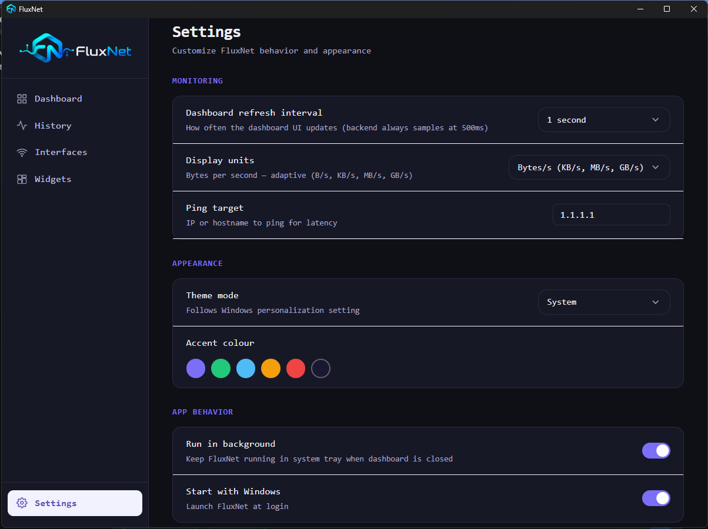

# FluxNet

<div align="center">
  
  <br>
  <strong>Real‑Time Network Monitoring for Windows</strong>
  <br>
  <sub>Lightweight · Native · Beautiful</sub>
</div>

---

[]()
[](https://tauri.app/)
[](https://react.dev/)
[](LICENSE)
[](https://github.com/venkideshVenu/fluxnet/actions)
[](https://github.com/venkideshVenu/fluxnet/releases)

---

## 📖 Table of Contents

- [Overview](#overview)
- [Features](#features)
- [Screenshots](#screenshots)
- [Technology Stack](#technology-stack)
- [Architecture Overview](#architecture-overview)
- [Getting Started](#getting-started)
  - [Prerequisites](#prerequisites)
  - [Installation](#installation)
  - [Development](#development)
  - [Building](#building)
- [Configuration](#configuration)
- [Project Structure](#project-structure)
- [Contributing](#contributing)
- [License](#license)
- [Acknowledgements](#acknowledgements)

---

## Overview

**FluxNet** is a production‑grade desktop application that brings real‑time network monitoring to your Windows system tray. With a focus on **performance**, **accuracy**, and **beauty**, FluxNet provides floating widgets that display live upload/download speeds, latency, and packet loss – all without cluttering your workflow.

Whether you are a developer debugging network‑dependent code, a gamer tracking latency, or a power user understanding bandwidth usage, FluxNet gives you the insights you need at a glance.

---

## Features

### 🚀 Real‑Time Monitoring

- **500ms sample interval** for accurate bandwidth measurements  
- Live upload and download speeds (B/s, KB/s, MB/s, GB/s)  
- Peak speed tracking since last reset  
- Connection status indicator (connected / disconnected)  

### 🖥️ Native Windows 11 Integration

- **Mica** and **Acrylic** materials for a modern look  
- System tray icon with quick access menu  
- Theme‑aware tray icon (light/dark)  
- Full DPI scaling support  

### 🧩 Floating Widgets

- **Pill** – minimal inline speed bar  
- **Compact** – detailed card with daily totals  
- **HUD** – gaming overlay with ping and loss  
- Drag‑to‑move and keyboard nudge (`Arrow` keys)  
- Individual opacity and always‑on‑top settings  

### 📊 Historical Data

- Persistent **SQLite** database  
- Raw samples stored for **7 days**  
- Hourly, daily, and monthly aggregates (kept forever)  
- Interactive charts with panning and zooming  
- Usage summary: Today, Week, Month, all‑time peaks  

### ⚙️ Customizable Settings

- Refresh interval (500ms – 5000ms)  
- Display units (Bytes or Bits per second)  
- Ping target (IP or hostname)  
- Minimize to tray behaviour  
- Theme mode (Light / Dark / System)  
- Accent colour picker  

### 🔒 Built for Performance

- CPU usage **< 2%** average  
- Memory footprint **< 150 MB**  
- Instant startup (< 2 seconds)  
- Zero data transmission – **100% local**  

---

## Screenshots

<div align="center">
  
  
  <br>
  
  
</div>

> _Placeholder – replace with actual screenshots from your `docs/screenshots/` folder._

---

## Technology Stack

| Layer           | Technology                                                                 |
| --------------- | -------------------------------------------------------------------------- |
| **Backend**     | Rust, Tauri, Tokio, SQLite, Windows API (`windows` crate), sysinfo         |
| **Frontend**    | React 19, TypeScript, Vite, Tailwind CSS, Zustand, Recharts                |
| **IPC**         | Tauri commands and events (JSON over WebSocket)                            |
| **Persistence** | SQLite (raw & aggregated data) + JSON (settings)                           |
| **Build**       | Tauri CLI, pnpm, GitHub Actions                                            |

---

## Architecture Overview

FluxNet follows a **layered architecture** with clear separation between the Rust backend and the React frontend.

```
┌─────────────────────────────────────────────────────────────────┐
│                     React Frontend (WebView)                    │
│  Dashboard | Widgets (Pill, Compact, HUD) | Settings | History  │
└─────────────────────────────────────────────────────────────────┘
                              │ IPC (Commands + Events)
┌─────────────────────────────────────────────────────────────────┐
│                     Tauri Core (Rust)                           │
│  ┌─────────────┐  ┌─────────────┐  ┌─────────────────────────┐ │
│  │  Sampler    │  │  Monitor    │  │  Tray & Window Manager  │ │
│  │  (500ms)    │  │  State      │  │                         │ │
│  └─────────────┘  └─────────────┘  └─────────────────────────┘ │
│  ┌─────────────┐  ┌─────────────┐  ┌─────────────────────────┐ │
│  │  SQLite DB  │  │  Settings   │  │  Widget State           │ │
│  │  (raw +     │  │  Store      │  │  (position, visibility) │ │
│  │   aggr.)    │  │             │  │                         │ │
│  └─────────────┘  └─────────────┘  └─────────────────────────┘ │
└─────────────────────────────────────────────────────────────────┘
                              │
┌─────────────────────────────────────────────────────────────────┐
│                    Platform Layer (Windows)                     │
│  • IP Helper API (GetAdaptersAddresses)                        │
│  • sysinfo counters (tx/rx)                                    │
│  • System tray / window management                             │
└─────────────────────────────────────────────────────────────────┘
```

- **Sampling Engine** runs every 500ms, reads network counters, calculates speeds, and stores samples.  
- **Aggregation Pipeline** rolls up data into hourly, daily, and monthly summaries.  
- **IPC** exposes commands (e.g., `get_network_stats`) and events (e.g., `network-stats`) for the frontend.  
- **Widgets** are separate WebView windows that subscribe to live data and handle drag/opacity/always‑on‑top.  

For a complete deep dive, see:

- [Backend Engineering Report](docs/FluxNet%20Backend%20Engineering%20Report.md)  
- [Frontend Engineering Report](docs/FRONTEND%20ENGINEERING%20REPORT.md)  

---

## Getting Started

### Prerequisites

- [Rust](https://www.rust-lang.org/tools/install) (MSRV: 1.70+)  
- [Node.js](https://nodejs.org/) (v18 or later)  
- [pnpm](https://pnpm.io/installation) (v8+)  
- Windows 10/11 (development and target – other platforms are planned but not yet supported)  

### Installation

Clone the repository:

```bash
git clone https://github.com/venkideshVenu/fluxnet.git
cd fluxnet
```

Install frontend dependencies:

```bash
pnpm install
```

### Development

Start the development server with hot‑reload:

```bash
pnpm dev
```

This will launch the Tauri development window with the React frontend at `http://localhost:1420`.

### Building

Build the production application:

```bash
pnpm tauri build
```

or use the dedicated npm script:

```bash
pnpm build:desktop
```

The installer (`.exe`) and portable binary will be placed in `src-tauri/target/release/bundle/`.

### Testing

Run frontend unit tests:

```bash
pnpm test
```

Run Rust tests:

```bash
cd src-tauri
cargo test
```

---

## Configuration

### Application Settings

User settings are stored in `%APPDATA%\fluxnet\app-settings.json` (Windows).  
The schema includes:

```json
{
  "pingTarget": "1.1.1.1",
  "refreshIntervalMs": 500,
  "onboardingCompleted": false,
  "minimizeToTray": true
}
```

### Widget State

Widget positions, visibility, and always‑on‑top flags are stored in `%APPDATA%\fluxnet\widget-state.json`.

### Database

Raw samples and aggregates are stored in `%APPDATA%\fluxnet\fluxnet.db` (SQLite).

---

## Project Structure

```
fluxnet/
├── src/                         # Frontend source
│   ├── api/                     # Tauri IPC wrappers
│   ├── components/              # React components (UI, widgets)
│   ├── hooks/                   # Custom React hooks
│   ├── pages/                   # Page components
│   ├── store/                   # Zustand stores
│   ├── styles/                  # Global CSS & design tokens
│   ├── types/                   # TypeScript type definitions
│   ├── utils/                   # Utility functions
│   ├── AppProviders.tsx         # Root providers
│   ├── DashboardApp.tsx         # Main application entry
│   ├── PillApp.tsx              # Pill widget entry
│   ├── CompactApp.tsx           # Compact widget entry
│   └── HudApp.tsx               # HUD widget entry
├── src-tauri/                   # Rust backend
│   ├── src/                     # Source code
│   │   ├── main.rs              # Entry point
│   │   ├── setup.rs             # App initialisation
│   │   ├── background/          # Sampler and background tasks
│   │   ├── commands/            # Tauri command handlers
│   │   ├── dto/                 # Data transfer objects
│   │   ├── monitor/             # Network monitoring logic
│   │   ├── persistence/         # Settings & widget state
│   │   ├── storage/             # Database & aggregation
│   │   ├── tray.rs              # System tray integration
│   │   └── theme.rs             # Theme detection
│   ├── Cargo.toml               # Rust dependencies
│   └── tauri.conf.json          # Tauri configuration
├── public/                      # Static assets
│   ├── favicon.ico
│   └── branding/                # Logos and icons
├── docs/                        # Documentation
│   ├── FluxNet Backend Engineering Report.md
│   └── FRONTEND ENGINEERING REPORT.md
├── package.json                 # Frontend dependencies
├── pnpm-lock.yaml               # Lockfile
├── tsconfig.json                # TypeScript config
├── vite.config.ts               # Vite config
└── README.md                    # This file
```

---

## License

Copyright (C) 2026 Venkidesh

FluxNet is licensed under the **GNU General Public License v3.0 (GPLv3)**.

This means you are free to:

- Use FluxNet
- Study the source code
- Modify the source code
- Distribute copies
- Distribute modified versions

Any distributed modifications must also be licensed under GPLv3 and provide source code.

See the [LICENSE](LICENSE) file for details.

---

## Acknowledgements

- [Tauri](https://tauri.app/) – the secure, cross‑platform app framework  
- [React](https://reactjs.org/) – UI library  
- [Recharts](https://recharts.org/) – charting library  
- [Zustand](https://zustand-demo.pmnd.rs/) – state management  
- [SQLite](https://www.sqlite.org/) – embedded database  
- All contributors and open‑source maintainers  

---

<div align="center">
  <sub>Built with ❤️.</sub>
</div>

---
