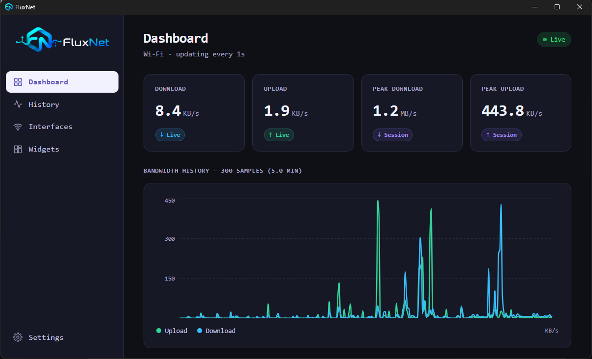
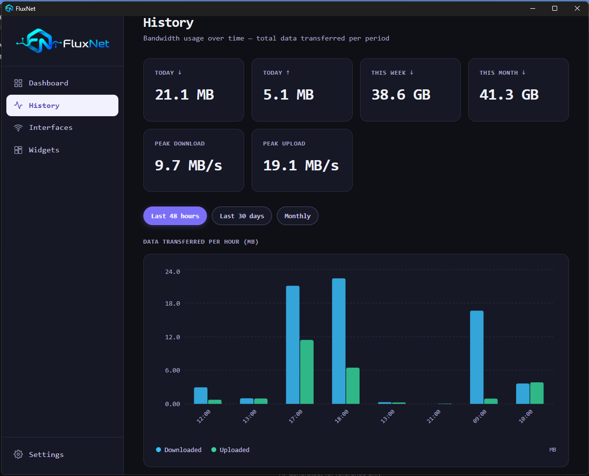
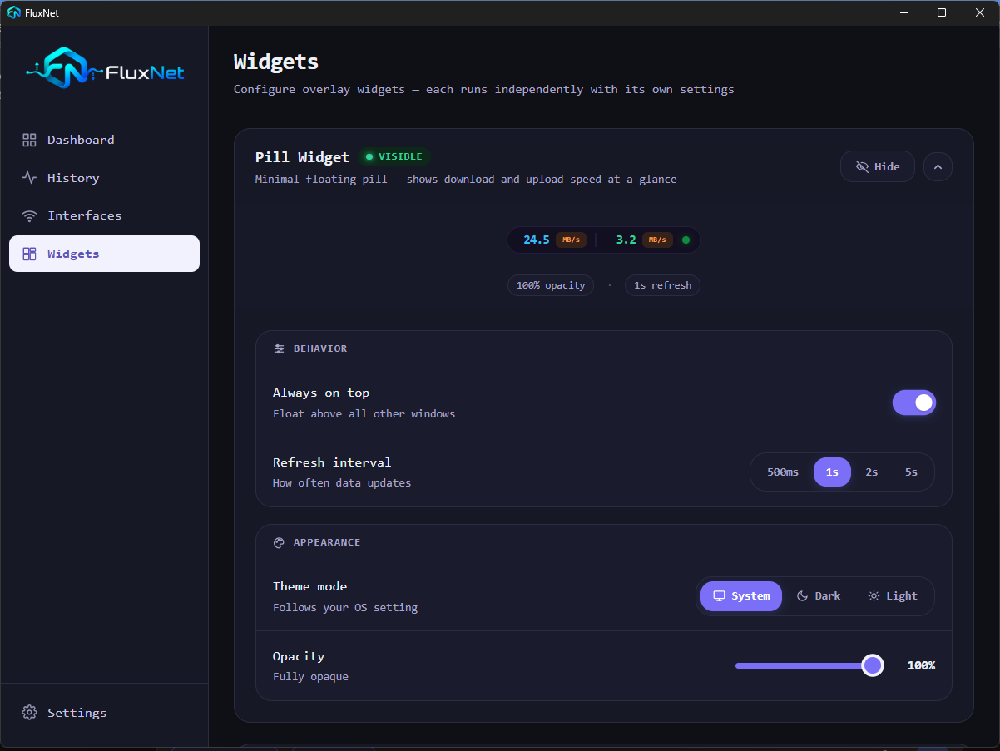

<div align="center">
  <picture>
    <source media="(prefers-color-scheme: dark)" srcset="public/branding/logo-horizontal-light.png">
    
  </picture>

  <p><strong>See your network speed at a glance on Windows.</strong></p>

[](https://github.com/venkideshVenu/FluxNet/actions/workflows/ci.yml)
[](https://github.com/venkideshVenu/FluxNet/releases/latest)
[](https://github.com/venkideshVenu/FluxNet/releases)
[](LICENSE)

</div>

FluxNet shows your download and upload speed live, from small desktop widgets
or a game overlay, and keeps a record of how much data you use. It runs in the
notification area, stores everything on your PC, and is built with Rust and
[Tauri](https://tauri.app/) to stay light.

<p align="center">
  
</p>

## Features

- **Live speeds.** Download and upload measured twice a second, with peak
  speeds and a live chart.
- **Desktop widgets.** A slim pill, a compact card with today's totals, and a
  game overlay with ping and packet loss. Drag them anywhere, including over the
  taskbar. Each has its own opacity, theme, refresh rate and always-on-top
  setting.
- **Data usage history.** Hourly, daily and monthly totals in charts or a
  table, kept for as long as you use FluxNet.
- **Adapter choice.** Follows the connection Windows uses (switching when you plug in a cable), or stays on
  the adapter you pick: Ethernet, Wi-Fi, USB tethering or VPN.
- **Fits into Windows 11.** Mica background, your accent colour, light and dark
  mode, and Windows Settings-style pages. Works on Windows 10 too.
- **Multi-monitor aware.** Widgets stay the right size on monitors with
  different scaling, and come back where you left them.
- **Private.** No account, no telemetry. See [Privacy](#privacy).

## Install

1. Download `FluxNet_x.y.z_x64-setup.exe` from the
   [latest release](https://github.com/venkideshVenu/FluxNet/releases/latest).
2. Run it. FluxNet installs for your user only and needs no administrator
   rights.
3. Follow the first-run setup to pick an adapter and turn on widgets.

Requires 64-bit Windows 10 or 11. The installer adds Microsoft WebView2 if it's
missing (Windows 11 already has it).

> [!NOTE]
> The installer isn't code-signed yet, so Windows SmartScreen may show
> "Windows protected your PC". Choose **More info**, then **Run anyway**. You
> can check the download against `SHA256SUMS.txt` on the release page with
> `Get-FileHash .\FluxNet_x.y.z_x64-setup.exe`.

## Using FluxNet

- Click the FluxNet icon in the notification area to open the main window.
  Right-click it to turn widgets on or off or to quit.
- Drag a widget to move it. With a widget selected, the arrow keys nudge it,
  and Shift moves it further.
- Closing the main window keeps FluxNet running in the notification area. You
  can turn this off in **Settings → Startup**.

## Privacy

FluxNet reads your network adapters' traffic counters. It never captures or
inspects your traffic. The only network traffic it creates is a ping to
Cloudflare's `1.1.1.1` every 5 seconds, which it uses to measure latency.

Everything stays on your PC:

| What                          | Where                                  |
| ----------------------------- | -------------------------------------- |
| Usage history (SQLite)        | `%APPDATA%\com.fluxnet.app\fluxnet.db` |
| Settings and widget positions | `%APPDATA%\com.fluxnet.app\*.json`     |
| Logs                          | `%APPDATA%\fluxnet\logs`               |

Uninstalling from **Settings → Apps** removes the app. Delete these folders as
well to remove your history.

## Screenshots

<table>
  <tr>
    <td></td>
    <td></td>
  </tr>
  <tr>
    <td align="center">Data usage</td>
    <td align="center">Widgets</td>
  </tr>
</table>

## Building from source

You need Node.js 24, pnpm, Rust and the
[Tauri prerequisites for Windows](https://tauri.app/start/prerequisites/#windows).

```bash
git clone https://github.com/venkideshVenu/FluxNet.git
cd FluxNet
pnpm install
pnpm dev            # run with hot reload
pnpm build:desktop  # build the installer into src-tauri/target/release/bundle
```

To work on the interface on macOS or Linux, run `pnpm dev:web`. It opens the
frontend in your browser with a simulated backend. See
[CONTRIBUTING.md](CONTRIBUTING.md) for the full setup, tests and checks.

## Documentation

- [Architecture](docs/ARCHITECTURE.md): how the backend, storage and windows fit together
- [Contributing](CONTRIBUTING.md): development setup, checks and pull requests
- [Releasing](docs/RELEASING.md): how a new version is published
- [Changelog](CHANGELOG.md): what changed in each version
- [Requirements](docs/requirements.md): the original specification

## Contributing

Bug reports, ideas and pull requests are welcome. Please read
[CONTRIBUTING.md](CONTRIBUTING.md) and follow the
[Code of Conduct](CODE_OF_CONDUCT.md). For security problems, see
[SECURITY.md](SECURITY.md) instead of opening an issue.

## License

Copyright © 2026 Venkidesh Venu.

FluxNet is free software, licensed under the
[GNU General Public License v3.0 or later](LICENSE). You can use, study, change
and share it. If you distribute a modified version, you must release its source
under the same license.

## Acknowledgements

Built with [Tauri](https://tauri.app/), [React](https://react.dev/),
[Recharts](https://recharts.org/), [Zustand](https://zustand.docs.pmnd.rs/),
[sysinfo](https://github.com/GuillaumeGomez/sysinfo),
[rusqlite](https://github.com/rusqlite/rusqlite) and
[Lucide](https://lucide.dev/) icons.
